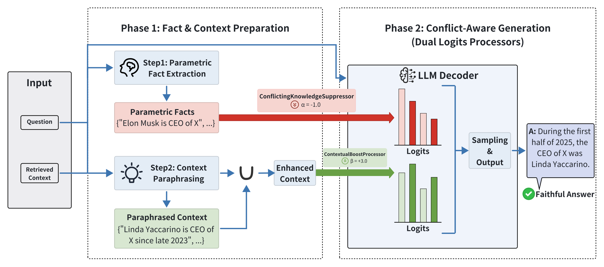

# CSRAG

Code for **Conflict-Suppressed RAG: A Simple Decoding-Time Framework for Faithful Retrieval-Augmented Generation** (NeurIPS 2026).

A training-free framework using vLLM for fact extraction, context paraphrasing, and conflict-aware answer generation.



## Install

Create a Miniconda environment:

```bash
conda create -n csrag python=3.12 -y
conda activate csrag
pip install -r requirements.txt
```

Set the path to your existing NLTK data directory and check the English stopwords:

```bash
export NLTK_DATA=/path/to/nltk_data
python -c "from nltk.corpus import stopwords; print('OK:', len(stopwords.words('english')))"
```

## Data

All eight processed evaluation files are included in `data/`:

- FaithEval: `faitheval_data.json`
- SQuAD: `squad_negative.json`, `squad_golden.json`
- MuSiQue: `musique_negative.json`, `musique_golden.json`
- Natural Questions: `NaturalQuestionsShort_kc_p_options.json`
- HotpotQA: `hotpotq_kc_p_options.json`
- NewsQA: `NewsQA_kc_p_options.json`

## Run

```bash
python src/pipeline.py \
  --model /path/to/Llama-3.1-8B-Instruct \
  --data data/faitheval_data.json \
  --output results/faitheval.json \
  --alpha -1 --beta 3
```

Each stage allows up to 4196 generated tokens. The default total context window is 16384 tokens.

## Evaluate

```bash
python src/eval.py --data data/faitheval_data.json --predictions results/faitheval.json
```

## License

Project code is released under the [MIT License](LICENSE). Third-party datasets and models retain their respective licenses and terms.
